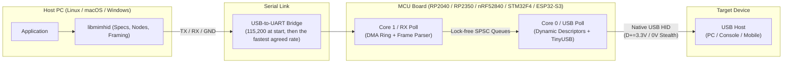

# libmimhid

Physical USB HID emulation for a target device, driven from a Linux, macOS, or Windows PC. The PC sends reports over a high-speed serial link to a microcontroller board—with official dual-core support for both the Raspberry Pi Pico (RP2040) and Raspberry Pi Pico 2 (RP2350), as well as ports for nRF52840, STM32F4, and ESP32-S3—which presents them to the target as a composite USB HID device.

The C ABI and the C++ header follow [`libaoahid`](https://github.com/nemarpuc/libaoahid): Specs, Nodes, the same option structures, the same input calls. Code written for one library moves to the other with minimal changes. The transport differs: `libaoahid` speaks Android Open Accessory over USB, whereas `libmimhid` speaks framed binary UART to an MCU coprocessor and requires no special mode, driver, or debugging setting on the target.

> [!NOTE]
> Version 2.0.1. Version 2.0.0 changed the API; see [CHANGELOG.md](CHANGELOG.md).

## Core Design

- **Ultra-low latency.** Input calls do not allocate on the hot path; one report submission is a single contiguous serial write (`3.3 µs/byte` at 3,000,000 baud; the host and the board agree the fastest rate the serial adapter carries). On RP2040 and RP2350, UART DMA runs into a dedicated `.scratch_y` SRAM bank polled by Core 1, handing off reports via lock-free single-producer single-consumer (SPSC) queues to Core 0 (`TinyUSB`) for 1000 Hz (`bInterval = 1 ms`) USB Interrupt IN delivery.
- **Minimal MCU load.** The host PC builds every HID report descriptor and encodes every report. The microcontroller acts strictly as a stateless-per-report I/O bridge: it knows nothing about keyboards, mice, or touchscreens, holds only the descriptors uploaded by the host, and forwards raw report payloads directly to USB endpoints.
- **High customizability & clean HAL.** Every USB identity field (VID, PID, release number, language, device class, power, remote wakeup, and string descriptors) and per-interface parameter (`iface.number`, the `ep_in` / `ep_out` address, `poll_interval_ms` and `max_packet_size`, `bcd_hid`, country code, boot protocol) is explicitly configured from the host without reflashing firmware. Hardware-specific code is isolated behind a small HAL (`firmware/common/hal.h`).
- **libaoahid model.** `mimhid_spec_create_*` builds an immutable descriptor and layout from an options structure; `mimhid_node_open` stages it on the board with an explicit interface number; `mimhid_node_open_raw` does the same for custom raw descriptors; `mimhid_device_batch_begin` / `mimhid_device_batch_end` combine several opens into one re-enumeration; `mimhid_keyboard_key`, `mimhid_mouse_move`, `mimhid_touchscreen_contact`, and the rest mutate a node; `mimhid_node_submit` sends. Descriptors are byte-identical to `libaoahid`'s for equal options.
- **Profiles.** Keyboard, mouse, toggle (consumer, system, telephony, camera), gamepad, touchscreen, touchpad, pen, digitizer, and raw HID (`mimhid_node_open_raw`). Battery Strength can be added to the profiles that support it.
- **Physical bus control.** `mimhid_device_connect()` and `mimhid_device_disconnect()` command physical D+=3.3V attachment or D+=0V stealth/silent disconnection at will. `mimhid_device_commit(device, delay_ms, timeouts)` handles staged dynamic re-enumeration with a controlled disconnect window.
- **Events from the target.** Output reports (keyboard LEDs), Feature reads, `SET_PROTOCOL`, `SET_IDLE`, mount, suspend, and resume reach your callback. `mimhid_node_set_feature_response` answers Feature reads.
- **Control transfers of the target.** Every request on endpoint 0 (descriptors, `GET_REPORT`, `SET_REPORT`, vendor requests) can be reported, and chosen ones answered from the program with data (sent whole, whatever `wLength` says), an acknowledgement or a STALL: `mimhid_device_set_control_routing` takes up to 8 rules, each with a required time and a required action for when no answer comes. Off until asked; the board answers by itself as before.
- **Timeouts at the call.** The Device keeps no wait: every call that can wait takes its time as an argument, and zero is refused with `MIMHID_ERR_UNSET_FIELD` ([API.md](docs/API.md#timeouts)). `MIMHID_CONTROL_TIMEOUT_MS` and the constants next to it are values that work.
- **Initial values, never guesses.** Each options structure has an `_init` function that fills in values that work, and a required field left zero is refused rather than filled in by the library. Only the vendor and product ID are left to you.
- **No input shaping.** The library does not smooth, pace, or randomize input.
- **Low level.** Applications that need no profile helper can stay at the low level: `mimhid_discover`, `mimhid_device_open`, `mimhid_node_open_raw`, `mimhid_raw_submit` / `mimhid_report_send`, and `event_sink`. [`docs/API.md`](docs/API.md) lists the calls by group; every call is documented in [`include/mimhid.h`](include/mimhid.h).

## Status

- Verified on hardware: Raspberry Pi Pico (RP2040) and Raspberry Pi Pico 2 (RP2350) are officially supported.
- Verified on the build host and in CI: the host library builds and passes its tests on Linux, macOS, and Windows; an end-to-end test runs the host library against the real firmware core through a pseudo-terminal (Linux and macOS); the firmware core is tested against a fake HAL; the firmware builds for RP2040, RP2350, nRF52840, STM32F4, and ESP32-S3.
- See [TARGET_MATRIX.md](docs/TARGET_MATRIX.md) for platform support details.

## Architecture & Hardware



Wiring and pins are in [QUICKSTART.md](docs/QUICKSTART.md).

## Building

Requirements: CMake 3.20+, a C11/C++20 compiler (GCC, Clang, MSVC 2019+, MinGW-w64). Firmware also needs `arm-none-eabi-gcc` and the SDK of the port.

```bash
cmake -B build -S . -DCMAKE_BUILD_TYPE=Release
cmake --build build --config Release
ctest --test-dir build -C Release --output-on-failure
```

This produces `libmimhid.so`, `libmimhid.dylib`, or `mimhid.dll` with `mimhid.lib`. Options: `MIMHID_BUILD_TESTS`, `MIMHID_BUILD_EXAMPLES`, `MIMHID_WERROR`, `MIMHID_SANITIZERS` (for example `address,undefined` or `thread`). To also run the end-to-end tests, pass `-DMIMHID_TINYUSB_PATH=<TinyUSB 0.18.0 checkout>` (POSIX only).

### Firmware

| Target | Prerequisites | Command |
|---|---|---|
| RP2040 (Raspberry Pi Pico) | [Pico SDK](https://github.com/raspberrypi/pico-sdk) 2.2.0 | `export PICO_SDK_PATH=<pico-sdk>`<br>`cmake -B build_fw -S firmware && cmake --build build_fw` |
| RP2350 (Raspberry Pi Pico 2) | Pico SDK 2.2.0 | `cmake -B build_fw -S firmware -DPICO_PLATFORM=rp2350 -DPICO_BOARD=pico2 && cmake --build build_fw` |
| nRF52840 | [TinyUSB](https://github.com/hathach/tinyusb) 0.18.0 and `python3 <tinyusb>/tools/get_deps.py nrf` | `cmake -B build_fw -S firmware/ports/nrf52840 -G Ninja -DTINYUSB_PATH=<tinyusb> && cmake --build build_fw` |
| STM32F4 | TinyUSB 0.18.0 and `get_deps.py stm32f4` | `cmake -B build_fw -S firmware/ports/stm32f4 -G Ninja -DTINYUSB_PATH=<tinyusb> && cmake --build build_fw` |
| ESP32-S3 | ESP-IDF 5.4 and TinyUSB 0.18.0 | `export TINYUSB_PATH=<tinyusb>`<br>`idf.py -C firmware/ports/esp32s3 set-target esp32s3 build` |

Host test of the firmware core: `cmake -B build_fwtest -S firmware/tests -DTINYUSB_PATH=<tinyusb> && cmake --build build_fwtest && ctest --test-dir build_fwtest`. Flashing is in the [Quickstart](docs/QUICKSTART.md#2-build-and-flash-the-firmware).

## Example

```c
#include <mimhid.h>

mimhid_device_config config;
mimhid_device_config_init(&config);   /* working values; see docs/API.md */
/* pid.codes test IDs, for testing in-house only: a device you hand out needs IDs of its own. */
config.usb_device.vendor_id = 0x1209;
config.usb_device.product_id = 0x0001;
config.transport.baud_rate = 3000000; /* the fastest rate mimhid_discover() found for the port */

mimhid_device* device = NULL;
mimhid_device_open("/dev/ttyACM0", &config, &device);

mimhid_keyboard_options keyboard;
mimhid_keyboard_options_init(&keyboard);
mimhid_spec* spec = NULL;
mimhid_spec_create_keyboard(&keyboard, &spec);

mimhid_node_config node;
mimhid_node_config_init(&node, 0);    /* interface 0, IN endpoint 0x81 */
mimhid_commit_timeouts timeouts;
mimhid_commit_timeouts_init(&timeouts);
mimhid_node* keys = NULL;
mimhid_node_open(device, spec, &node, &timeouts, &keys); /* the board attaches to the target */
mimhid_spec_release(spec);                               /* the Node keeps its own reference */
mimhid_device_wait_ready(device, 5000);

mimhid_keyboard_key(keys, 0x04, 1);   /* Keyboard a */
mimhid_node_submit(keys, MIMHID_SEND_TIMEOUT_MS);
mimhid_keyboard_key(keys, 0x04, 0);
mimhid_node_submit(keys, MIMHID_SEND_TIMEOUT_MS);

mimhid_device_close(device, MIMHID_CONTROL_TIMEOUT_MS, MIMHID_DRAIN_TIMEOUT_MS); /* closes keys too */
```

Every call returns a `mimhid_result`; check it, and read `mimhid_last_error()` for the details. Complete programs: [`examples/`](examples/) and [EXAMPLES.md](docs/EXAMPLES.md).

## Moving between libaoahid and libmimhid

| | `libaoahid` | `libmimhid` |
|---|---|---|
| Header | `aoahid.h` / `aoahid.hpp` | `mimhid.h` / `mimhid.hpp` |
| Link | USB to an Android device | UART to an MCU board, which presents USB to any target |
| Open | `aoahid_context_*`, `aoahid_device_open` | `mimhid_device_open(port_path, ...)` (no context) |
| Spec, options, node calls | `aoahid_spec_create_*`, `aoahid_node_*`, `aoahid_keyboard_key`, ... | same names with the `mimhid_` prefix |
| Waits | every call that can wait takes its timeout as an argument (`control_timeout_ms`, `send_timeout_ms`, `drain_timeout_ms`; libaoahid 2.0 and later) | the same rule and names; `mimhid_commit_timeouts` adds the wait for the board's re-enumeration |
| Node id, error detail | `aoahid_node_id`; `aoahid_error_detail.node_id`, `.transport_status` | `mimhid_node_id`; `mimhid_error_detail.node_id`, `.transport_status` |
| Opening a node | registers an accessory HID device | `mimhid_node_open` / `mimhid_node_open_raw` (one re-enumeration each, or one per `mimhid_device_batch_begin` / `mimhid_device_batch_end`) |
| Interface setup | implicit / accessory defined | `mimhid_node_config`: the interface number and endpoints are explicit (`mimhid_node_config_init(&config, n)`) |
| USB identity | fixed Google accessory ID | set in `mimhid_device_config` |
| Physical bus control | handled by Android OS | `mimhid_device_connect()`, `mimhid_device_disconnect()`, `mimhid_device_commit()` |
| Output of the target | AOA has none | `event_sink` |
| Control transfers of the target | AOA has none | `mimhid_device_set_control_routing`, `mimhid_device_control_reply` |

## Releases

A pushed `v*` tag builds and checks the release, then publishes a GitHub Release. For version `X.Y.Z` it uploads, in the same layout as `libaoahid`:

- twelve archives: `libmimhid-X.Y.Z-linux-{x86_64,aarch64}-ubuntu22.04-{shared,static}.tar.gz`, `libmimhid-X.Y.Z-macos-{arm64,x86_64}-{shared,static}.tar.gz`, and `libmimhid-X.Y.Z-windows-{x86_64,arm64}-{shared,static}.zip`, each with headers, the library, CMake package files, and pkg-config files;
- twelve matching `.spdx.json` SBOM sidecars;
- six runtime bundles (`...-runtime.tar.gz`, `...-runtime.zip`) with only the shared library and the license/notice documents (`LICENSE`, `NOTICE`, `THIRD_PARTY_NOTICES.md`, `CHANGELOG.md`);
- the tagged tree as `libmimhid-X.Y.Z-source.tar.gz`;
- `release-manifest.json` and `SHA256SUMS`;
- the firmware images: `mimhid_firmware-<board>-X.Y.Z.{uf2,hex,bin}` for rp2040, rp2350, nrf52840, stm32f4, and esp32s3, accompanied by `mimhid_firmware-THIRD_PARTY_NOTICES-X.Y.Z.txt`.

Linux archives target glibc 2.35 (Ubuntu 22.04); macOS archives target macOS 11 and are signed ad hoc, not notarized; Windows archives use the dynamic MSVC runtime. The AArch64 Linux and ARM64 Windows libraries are cross-built and are not run in CI. Consume an archive with `find_package(mimhid COMPONENTS shared)` (or `static`) or with pkg-config (`mimhid`, `mimhid-static`).

## Documentation

- [Quickstart](docs/QUICKSTART.md): wiring, flashing, first run.
- [API](docs/API.md): the model, the lifecycle, and where each call is documented.
- [Examples](docs/EXAMPLES.md)
- [Profiles](docs/PROFILES.md)
- [Architecture](docs/ARCHITECTURE.md) and [wire protocol](docs/PROTOCOL.md)
- [Limits](docs/LIMITS.md), [latency](docs/LATENCY.md), [porting](docs/PORTING.md), [target matrix](docs/TARGET_MATRIX.md)

## License

MIT. Copyright (c) 2026 libmimhid contributors. See [LICENSE](LICENSE), [NOTICE](NOTICE), and [THIRD_PARTY_NOTICES.md](THIRD_PARTY_NOTICES.md) for third-party firmware SDK attributions.
