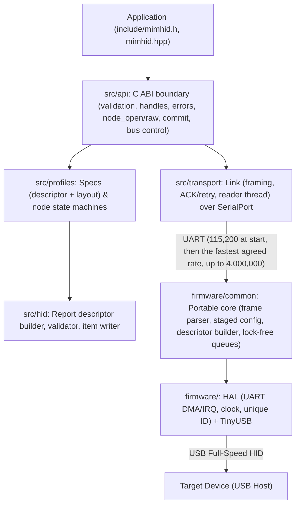
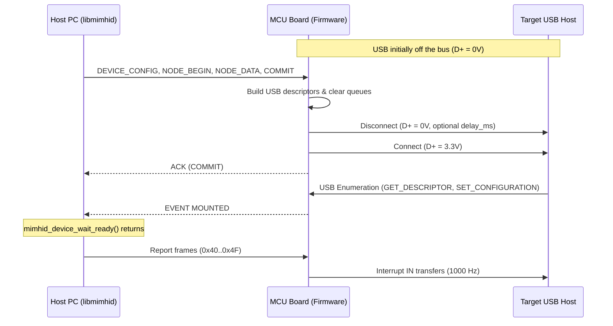

# Architecture

Wire details are in [PROTOCOL.md](PROTOCOL.md), the API model in [API.md](API.md), timing in [LATENCY.md](LATENCY.md).

## libaoahid and libmimhid

`libaoahid` is a USB host that talks Android Open Accessory to a phone. `libmimhid` talks UART to a board that is a USB device to the target, so the target needs no special mode, no app, and no debugging setting.

| | `libaoahid` | `libmimhid` |
|---|---|---|
| Link | PC USB to phone | PC UART to MCU board, board USB to target |
| Target sees | an Android accessory | an ordinary USB HID device with your VID/PID and strings |
| Where reports are built | on the PC | on the PC (the same code) |
| Where descriptors live | registered with the phone by vendor requests | uploaded to the board, served in USB enumeration |

## Layers

The host builds every report. The firmware does not know what a keyboard or a touchscreen is: it holds the descriptors the host uploaded, builds the USB device, configuration, and string descriptors from them, and forwards report bytes to the interface the host assigned.

## Host

- `Spec` is immutable and reference counted; `Node` holds the mutable state (pressed keys, contact slots, pending motion) and the USB interface settings.
- `mimhid_node_open` and `mimhid_node_open_raw` put nodes onto explicit interface numbers (`interface_number` in `mimhid_node_options`).
- Applying the configuration (`mimhid_node_open`, `mimhid_node_open_raw`, `mimhid_node_close`, `mimhid_device_batch_end`, `mimhid_device_commit`) sends `DEVICE_CONFIG`, every `NODE_BEGIN` / `NODE_DATA`, the Feature answers, and `COMMIT`, then waits for the board's ACK (sent after reconnect). While this runs, input calls return `MIMHID_ERR_BUSY`.
- `mimhid_device_connect` and `mimhid_device_disconnect` command physical D+=3.3V attachment or D+=0V stealth disconnection.
- A reader thread parses frames from the board, answers nothing itself, completes pending commands, tracks the mounted state, and delivers events to `event_sink`.
- Reports are written from the caller's thread, one `write` each, under a transmit lock. No allocation happens on this path.
- Closing a node sends its neutral report (all keys up, contacts lifted) before the configuration changes.

## Interface configuration

In `libmimhid`, each node explicitly specifies its USB `interface_number` (0, 1, 2...) via `mimhid_node_options`. There is no automatic interface assignment. Each interface specifies `ep_in_size` (e.g. 64) and optional `ep_out_size` (0 for disabled, 8/16/32/64 for enabled) along with poll intervals and protocol parameters. If a configuration exceeds the board's `max_interfaces` or descriptor memory, `mimhid_node_open` returns `MIMHID_ERR_OVERFLOW`.

## Firmware

`firmware/common/core.c` has two halves that a port runs in one loop or on two cores:

- **Receive side** (`mimhid_rx_poll`): reads bytes through `hal_uart_read` into a 512-byte ring, parses frames, and handles reports and commands. Reports go to a per-interface single-producer single-consumer queue of 16. Commands are pushed to a small mailbox so that the USB side executes them; the receive side never touches the active descriptors.
- **USB side** (`mimhid_usb_poll`, with `tud_task`): executes commands (`COMMIT` rebuilds the descriptors with `mimhid_apply_config`, disconnects, and reconnects), and services the interface queues in rotation, one report per ready endpoint.

`firmware/common/usb_descriptors.c` builds the device descriptor (VID, PID, class, strings), the configuration descriptor (one HID interface with IN and optional OUT endpoints per interface), the string table, and serves each report descriptor. TinyUSB 0.18.0 specifics: `GET_REPORT` input includes the Report ID when the interface uses IDs, and `tud_hid_n_report` with ID 0 sends the buffer as is.

Both the Raspberry Pi Pico (RP2040) and Raspberry Pi Pico 2 (RP2350) have official dual-core hardware support: the receive side runs on core 1 and the USB side on core 0; the DMA ring for the UART sits in the dedicated `.scratch_y` SRAM bank so that it does not contend with core 0. The other ports use one loop.

## Re-enumeration

## Tests

- `tests/unit`: HID layer and profile state machines. `tests/hidtools`: descriptors against `libaoahid`'s golden files.
- `tests/abi`: the headers from C and C++, structure layouts.
- `tests/e2e`: the host library against the real firmware core (`firmware/common`) on the build host, through a pseudo-terminal, with TinyUSB replaced by recording stubs. It checks the descriptors the target would receive, reports, events, batching, and error cases for 7- and 3-interface builds.
- `firmware/tests`: the firmware core against a fake HAL with real TinyUSB headers.
