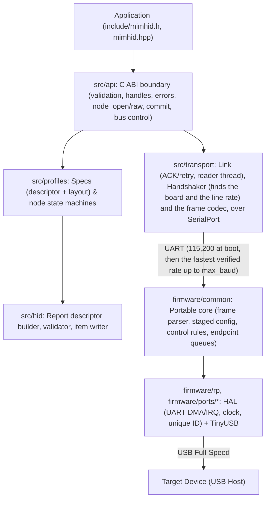

# Architecture

Wire details are in [PROTOCOL.md](PROTOCOL.md), the API model in [API.md](API.md), internal host ownership and locking in [INTERNALS.md](INTERNALS.md), and timing in [LATENCY.md](LATENCY.md).

## libaoahid and libmimhid

`libaoahid` is a USB host that talks Android Open Accessory to a phone. `libmimhid` talks UART to a board that is a USB device to the target, so the target needs no special mode, no app, and no debugging setting.

| | `libaoahid` | `libmimhid` |
|---|---|---|
| Link | PC USB to phone | PC UART to MCU board, board USB to target |
| Target sees | an Android accessory | an ordinary USB device (HID or any class you describe) with your VID/PID and strings |
| Where reports are built | on the PC | on the PC (the same code) |
| Where descriptors live | registered with the phone by vendor requests | uploaded to the board, served in USB enumeration |

## Layers

The host builds every report. The firmware does not know what a keyboard or a touchscreen is, or what a HID interface is: it holds the descriptors the host uploaded, serves them, answers control requests from a table of rules the host wrote, and forwards the bytes of each transfer to the endpoint the host named. TinyUSB's HID driver is not used: every interface runs on the generic driver, and what HID asks of endpoint 0 is a set of rules the host's profile layer writes.

## Host

- `Spec` is immutable and reference counted; `Node` holds the mutable state (pressed keys, contact slots, pending motion) and the USB interface settings.
- `mimhid_node_open` (any class, from `mimhid_node_config`: interfaces, endpoints, class descriptors, an association), `mimhid_node_open_profile` (a HID collection from a Spec, with `mimhid_hid_node_config`) put nodes onto explicit interface numbers, which are the `bInterfaceNumber` the target sees: a commit needs the numbers in use to be 0, 1, 2, ... without a gap.
- `src/usb/hid_layer.cpp` turns the profile Nodes into interfaces (shared interfaces, joined report descriptors, `compose_hid_groups`) and writes the control rules that make them behave as HID 1.11 asks (`compose_hid_rules`); `src/usb/descriptor_composer.cpp` knows no class: it takes interfaces with their endpoints and class bytes and composes the device, configuration and string descriptors from the Device options and the open Nodes. It is pure (no I/O) and is tested byte for byte.
- Applying a configuration (`mimhid_node_open`, `mimhid_node_open_profile`, `mimhid_node_close`, `mimhid_device_batch_end`, `mimhid_device_commit`, `mimhid_device_set_usb_identity`, and `mimhid_device_connect` on a Device that is not on the target) runs `commit_device` (`src/api/device_ops.cpp`):
  - When nodes are left, the host composes the descriptors and the control rules (`build_rule_table`: the Nodes' rules in node order, the library's rules for each profile interface among them, then the Device's own) and sends `DESC_RESET`, the device, configuration and string descriptors (`DESC_BEGIN` and `DESC_DATA`), every `RULE` with the bytes of its answer, and an `EP_CONFIG` for every IN endpoint. Each frame waits up to `control_timeout_ms` and is sent up to three times.
  - If the board is already on the target's bus, the host sends a detach `COMMIT` (`Link::disconnect`, payload `{1, 0, 0}`) and then waits `reconnect_delay_ms` (the argument of `mimhid_device_commit`; the other calls pass 0) on the host.
  - The host sends an attach `COMMIT` (`Link::connect`, payload `{0, 0, 0}`) and waits up to `reconnect_timeout_ms` for its `ACK`, which the board sends right after walking and applying the staged configuration and calling `tud_connect()`. The rules are active with it. The call returns then; a Device that asked to report every control transfer gets a `RULES_APPLY` straight after; `mimhid_device_wait_ready` waits for `EVENT MOUNTED`. While a commit runs, input calls return `MIMHID_ERR_BUSY`.
  - When no node is left, the host sends only a detach `COMMIT`.
- `mimhid_device_connect` and `mimhid_device_disconnect` turn the board's D+ pull-up on and off.
- A reader thread parses frames from the board, completes the pending command, tracks the mounted state, and delivers events to `event_sink`. It also turns the events of a profile Node's interface into HID events (`deliver_event`): an `ACCEPT` event of `SET_REPORT`, `SET_IDLE` or `SET_PROTOCOL`, or an `EP_OUT` frame of its OUT endpoint, becomes `MIMHID_EVENT_OUTPUT_REPORT`, `_FEATURE_REPORT`, `_SET_IDLE` or `_SET_PROTOCOL`, and the answers to `GET_IDLE` and `GET_PROTOCOL` follow what the target set. The reader thread cannot wait for the board, so it hands the change of those answer bytes (`RULE_DATA`) to an updater thread of the Device (`updater_loop`), started with the first commit and stopped at close.
- Reports are written from the caller's thread through `endpoint_write` (`src/api/c_api_endpoint.cpp`, shared with `mimhid_node_endpoint_write`), under a transmit lock (`Link::tx_mutex_`), from a stack buffer (`c_api_send.cpp`); a profile Node's IN endpoint has its own `EndpointRuntime`, so it has a queue policy like any other.
- `mimhid_node_endpoint_write` sends the transfers of an IN endpoint as `EP_IN` frames split on packet boundaries; with the wait policy it counts frames against the board's `EP_DONE` events and blocks on a condition variable with no Device lock held. `EP_OUT` frames become `MIMHID_EVENT_ENDPOINT_DATA`.
- Closing a node sends its neutral report (all keys up, contacts lifted) before the configuration changes.

## Interface configuration

Each node names its USB interface with `mimhid_usb_interface.number` (`interface_number` in `mimhid_hid_node_config`); nothing assigns interfaces automatically. Each interface gives `ep_in.address` (`0x81..0x8F`), `ep_in.max_packet_size` (1 to the board's `max_endpoint_bytes`), and an optional OUT endpoint (`ep_out.address` 0 when there is none, otherwise `0x01..0x0F` with `ep_out.max_packet_size` from 1 to `max_endpoint_bytes`), with poll intervals and protocol fields. When a configuration exceeds the board's `max_interfaces_any`, `max_endpoint_number`, `max_config_descriptor_bytes`, `max_control_rules`, `max_answer_bytes` or `endpoint_queue_slots`, `mimhid_node_open` returns `MIMHID_ERR_OVERFLOW`.

## A Device given as bytes

`mimhid_device_set_descriptors` (`src/api/c_api_bytes.cpp`) gives the board the descriptors of a whole device as bytes, for a copy of a real device. `walk_descriptors` (`src/usb/descriptor_walker.cpp`) checks them the way the board does at `COMMIT` (device descriptor, configuration, interface numbers 0, 1, 2, ... with their alternate settings 0, 1, 2, ..., interrupt, bulk and isochronous endpoints with addresses unique in a setting and the same endpoint across the settings of one interface, BOS header and capability lengths) so that a refusal names the byte offset; it reads no class. The Device then holds no Node: `ByteDevice` in `mimhid_device` keeps the bytes, the interface of each endpoint address and the runtime (policy, wait count) of every IN endpoint, and `commit_device` sends them like a composed configuration. The endpoint calls (`mimhid_device_endpoint_*`) use the same `endpoint_write` as the Node calls, and the packets of an OUT endpoint are `MIMHID_EVENT_ENDPOINT_DATA` with node id 0 (`node_of_endpoint`). A Device given as bytes and Nodes exclude each other (`MIMHID_ERR_BUSY`).

## Firmware

`firmware/common/core.c` has two halves that a port runs in one loop (`mimhid_run`) or on two cores:

- **Receive side** (`mimhid_rx_poll`): reads bytes through `hal_uart_read` into a ring (`g_rx`; `RX_SIZE` is 1024, 4096 or 8192 bytes, chosen by `MIMHID_MAX_FRAME_PAYLOAD`), parses frames, and handles reports and some commands. An `EP_IN` frame goes to the single-producer single-consumer queue of its IN endpoint (`mimhid_generic_in_reserve` and `_in_commit`), a ring cut from the board's pool of slots at `COMMIT` or `EP_CONFIG` by the endpoint's depth and policy. `mimhid_node_endpoint_set_policy` sets them. `PING`, `SET_BAUD`, `PROBE`, `COUNTERS`, and `CONTROL_REPLY` are handled here; every other command goes into a mailbox for the USB side (`g_cmd`, `cmd_push`: a ring of four slots that holds three commands).
- **USB side** (`mimhid_usb_poll`, after `tud_task`): runs the mailbox commands (`run_command`), staging included: `DESC_RESET`, `DESC_BEGIN`, and `DESC_DATA` fill the staged configuration (`g_staged`: the descriptors as bytes), an attach `COMMIT` walks it and makes it the active one (`mimhid_apply_config`, which refuses what does not hold together: see [PROTOCOL.md](PROTOCOL.md#the-commit-walk)), clears the queues, and calls `tud_connect()`, and a detach `COMMIT` calls `tud_disconnect()` and clears the active configuration. It also serves the endpoint queues in turn, one transfer per ready endpoint, and runs the control side (`RULE`, `RULES_APPLY`, `RULE_DATA` and the replies to held transfers).

`firmware/common/generic.c` is a TinyUSB application driver (`usbd_app_driver_get_cb`; the stack tries application drivers before its own, `get_driver` in TinyUSB's `usbd.c`) for every interface, whatever its class: HID, which TinyUSB's own HID driver (`CFG_TUD_HID` is 0) served until 0.3, included. Its `open` opens the endpoints of the interface, or of a whole association group, and arms the OUT endpoints. Each IN endpoint has a ring of slots cut at COMMIT from one pool (`MIMHID_EP_POOL_SLOTS`), written by the receive side and drained by the USB side. When the USB side starts a transfer it copies the slot into a buffer of that endpoint and frees the slot before `usbd_edpt_xfer`: the controller keeps the pointer until the target has taken the transfer, and a flush, a stall or the drop-oldest policy may hand the slot back to the receive side long before that. An OUT endpoint is armed for one packet; the packet goes to the host as an `EP_OUT` frame, and only then is the endpoint armed again, so the target waits on NAKs while the link is busy.

`firmware/common/control.c` and `firmware/common/ep0.c` sit between the USB controller driver and TinyUSB. `control.c` wraps `dcd_event_handler` (`-Wl,--wrap=dcd_event_handler`) to see the 8-byte setup packet of every control transfer, looks it up in the table of rules, answers it itself when the rule says (`ANSWER`, `ANSWER_LAST_SENT`, `ACCEPT`, `STALL`), and for an `ASK` rule reports it and holds it until the host replies or the rule's timeout runs out (see [PROTOCOL.md](PROTOCOL.md#control-rules)). Two copies of the table are kept, the active one the USB interrupt reads and the staged one the receive side writes; `RULES_APPLY` and `COMMIT` swap them with the interrupt masked, and `RULE_DATA` and `RULES_APPLY` answer `NAK_BUSY` while an answer is being sent from the active answer memory. `ep0.c` wraps `dcd_edpt_xfer` and `dcd_edpt_stall` so that with a `usb_device.ep0_max_packet_size` of 8, 16, or 32 bytes, transfers on endpoint 0 are split into packets of that size instead of TinyUSB's compile-time `CFG_TUD_ENDPOINT0_SIZE` (64).

`firmware/common/usb_descriptors.c` serves the device, configuration and UTF-16LE string descriptors the host sent, as bytes. It builds nothing and knows no class; a report descriptor is the answer of a rule. The generic driver sends each transfer as the host sent it (a Report ID is only its first byte), and an `ANSWER_LAST_SENT` rule returns the last transfer sent, so `GET_REPORT` of an Input report is that report with its Report ID in front, as HID 1.11 7.2.1 describes.

Alternate settings and isochronous endpoints (`firmware/common/generic.c`, "the endpoints of a configuration") add nothing to that. `gen_open` is called once per interface (or association), and the span the walk recorded takes the interface's settings with it; it opens each bulk or interrupt endpoint once, gives each isochronous one a packet buffer (`usbd_edpt_iso_alloc`, the largest packet of its settings; on the RP2040 `usbd_edpt_close` does nothing, so nothing is ever closed) and starts the endpoints of setting 0. `SET_INTERFACE` reaches the driver's `control_xfer_cb`: the isochronous endpoints of the setting left stop (`ep_stop`: queue dropped, `open` cleared), those of the setting selected start (`ep_start`: `usbd_edpt_iso_activate` with the descriptor of that setting, then the same queue and `usbd_edpt_xfer` as any IN endpoint, or `out_arm` for an OUT one), and the host is told with the `SET_INTERFACE` event. An isochronous IN transfer is queued, copied to the endpoint's bus buffer and handed to the controller like a bulk one; the controller sends it when the target's next frame asks, and when nothing is queued the frame passes empty. The board has no clock of its own for a stream, no padding, no resampling and no feedback endpoint: the program that wrote the descriptors owns all of it. `MIMHID_ISO_BYTES` (core.h) is the port's switch: 0 leaves the PONG's isochronous bit clear and the walk refuses the type.

On the RP2040 and RP2350 (`firmware/rp/`) the receive side runs on core 1 and the USB side on core 0 (`firmware/rp/main.c`); the UART is read by DMA into a 1024-byte ring (`DMA_BUF_SIZE` in `firmware/rp/hal_rp.c`) placed in the `.scratch_y` SRAM bank, and both cores write to the UART under one critical section (`g_uart_tx_lock`). The other ports run `mimhid_run()` on one core.

## Re-enumeration

## Design decisions

Each decision states what the code does. A reason is given only where the repository records one (a code comment, `CHANGELOG.md`, or a commit message), and says where.

### No values in `*_init`

- **Decision:** Every `mimhid_*_init` function (and its `mimhid::` twin) zeroes its structure and sets `struct_size`, and nothing else. A required field left at zero is refused with `MIMHID_ERR_UNSET_FIELD`, and `mimhid_last_error()` names it. The firmware refuses the same zeros on the wire (`NAK_PARAM`).
- **Reason:** Recorded for one field: `CHANGELOG.md` `[0.2.0]` says a zero vendor ID is refused "so a program that forgot it no longer presents `0000:xxxx` (or, until now, the pid.codes test IDs the initializer used to put in)". `examples/c/example_values.h` says the values it sets "are examples of what a program decides; none is a default of the library". No reason is recorded for the other fields.
- **Rejected:** Initializers with working values. Commit `621900c` added them ("Every options structure has an initializer with working values"); commit `cce3c83` (0.2.0) removed them.

### Every timeout is an argument

- **Decision:** No handle keeps a timeout and `mimhid.h` has no timeout constant. Every call that can wait takes its timeouts as arguments (`mimhid_commit_timeouts` for a commit) and refuses 0 with `MIMHID_ERR_UNSET_FIELD`.
- **Reason:** Not recorded. Commit `4bb017b` states the decision ("All waits are passed per call and none has a default or is kept in the Device").
- **Rejected:** The four `mimhid_transport_options` timeout fields (removed in `4bb017b`) and the constants `MIMHID_CONTROL_TIMEOUT_MS`, `MIMHID_SEND_TIMEOUT_MS`, `MIMHID_DRAIN_TIMEOUT_MS`, and `MIMHID_RECONNECT_TIMEOUT_MS` (removed in `cce3c83`, `CHANGELOG.md` `[0.2.0]`).

### Descriptors and USB identity come from the host

- **Decision:** The host composes every USB descriptor (device, configuration and strings) and sends the bytes over the serial link (`DESC_RESET`, `DESC_BEGIN`, `DESC_DATA`, `COMMIT`); data frames name endpoints. It also writes the control rules, among them the answers a HID interface needs (the report descriptor, the HID descriptor, `GET_REPORT`, the idle rate, the protocol), and sends them as `RULE` frames. The firmware holds no HID profile and builds no descriptor; it checks the configuration and the rules once at `COMMIT` (what its USB stack and controller can run) and serves the bytes unchanged. Since 0.3.0 every interface of any class runs on the generic driver and TinyUSB's HID driver is not built (`CFG_TUD_HID` 0).
- **Reason:** Not recorded beyond the README's statement of the result: "One firmware image per MCU serves any USB identity, interface layout, and report descriptor sent at runtime."
- **Rejected:** Not recorded.

### D+ stays off until the first `COMMIT` and after a detach

- **Decision:** `mimhid_core_init` calls `tud_disconnect()`, so the D+ pull-up is off from power-up. The board turns it on only for an attach `COMMIT` that succeeds, and turns it off for a detach `COMMIT` and for `mimhid_device_close` (unless `keep_attached` is 1). On the nRF52840, `__wrap_tusb_hal_nrf_power_event` takes the pull-up down again after every USB power event while `mimhid_core_attached()` is false.
- **Reason:** Recorded for the nRF52840: its comment says TinyUSB raises the pull-up "on every USB_EVT_READY ... whatever tud_disconnect() did before", and `CHANGELOG.md` `[0.2.0]` says the change means "a board that has not been committed no longer enumerates as `CAFE:4000` with no interface when the cable is plugged in". Not recorded for the decision as a whole.
- **Rejected:** Not recorded.

### The line rate is found by measurement

- **Decision:** The board boots at 115,200 baud (`MIMHID_BOOT_BAUD`). The host reads `max_baud` from the `PONG`, switches with `SET_BAUD`, and keeps a rate only when three pings and a burst of `PROBE` frames get through with the board's error counters (`COUNTERS`) at zero. The board returns to the boot rate when no valid frame arrives within 100 ms (`MIMHID_BAUD_CONFIRM_MS`) and on a UART `BREAK`.
- **Reason:** Commit `7659d02`: the rate is kept "only after three pings each way, so an adapter that sends at another rate is caught". Commit `bc08c47`: a BREAK returns the board to the boot rate "so a board left on a fast rate is found without searching". `firmware/common/core.c` on BREAK: what the board holds "was sent at the old rate and means nothing".
- **Rejected:** A table of fixed rates, removed in commit `bc08c47` ("The fixed rate table is gone; only the 115,200 boot rate stays"); why the table was dropped is not recorded.

### A stable C ABI over a C++20 implementation

- **Decision:** The libraries export only the `extern "C"` functions of `include/mimhid.h`, through `cmake/mimhid.map` on Linux and `cmake/mimhid.exports` on macOS. On Linux the shared library links the C++ runtime statically (`-static-libstdc++ -static-libgcc`, except in sanitizer builds). C++ exceptions are caught at the C ABI by `MIMHID_C_RESULT_CATCH`, `MIMHID_C_VALUE_CATCH`, and `MIMHID_C_VOID_CATCH` (`src/api/support.hpp`). `include/mimhid.hpp` is a header-only layer over `mimhid.h`, linked through the `mimhid::cpp` CMake target.
- **Reason:** `CMakeLists.txt` records two: "The ABI is plain C: the C++ runtime stays private to the shared object", and the C++ facade target exists so that a pure-C consumer does not have to enable C++ "merely to link the library". Not recorded beyond that.
- **Rejected:** Not recorded.

## Tests

- `tests/unit`: HID layer and profile state machines (`mimhid.unit`). `tests/hidtools/export_descriptors.cpp`: every profile's descriptor compared byte for byte with the files in `tests/golden` (`mimhid.golden-descriptors`).
- `tests/abi`: headers compiled from C11 and C++20 (`mimhid.c-abi`, `mimhid.cpp-wrapper`) and structure layout verification (`mimhid.abi-layout-oracle`).
- `tests/scripted`: the host library run over a pseudo-terminal against a programmable scripted peer (`mimhid.scripted`) that injects NAKs, corrupted CRCs, silent timeouts, rate refusals, and mid-operation hangups.
- `tests/sim`: the host library run against the real firmware core (`firmware/common`) on the build host through a pseudo-terminal (`tests/sim/fake_board.c`), with TinyUSB replaced by recording stubs. It checks the descriptors the target would receive, reports, events, batching, control rules, and error cases for Full-Speed builds with 15, 7 and 3 endpoint numbers and a High-Speed build (`mimhid.sim-15`, `mimhid.sim-7`, `mimhid.sim-3`, `mimhid.sim-hs`).
- `firmware/tests`: the firmware core tested directly against a fake HAL with real TinyUSB headers (`test_core_15`, `test_core_7`, `test_core_6`, `test_core_3`, `test_core_hs`, named by the highest endpoint number of the port; CTest names `firmware_core_15`, `firmware_core_7`, `firmware_core_6`, `firmware_core_3`, `firmware_core_hs`), and `firmware/tests/port_probe.c`, built in every header order (`probe_first_core_*`, `probe_first_tusb_*`) and with each required build definition missing (`missing_*`).
- See [VERIFICATION.md](VERIFICATION.md) for the verification matrix and where the coverage figures are reported.
