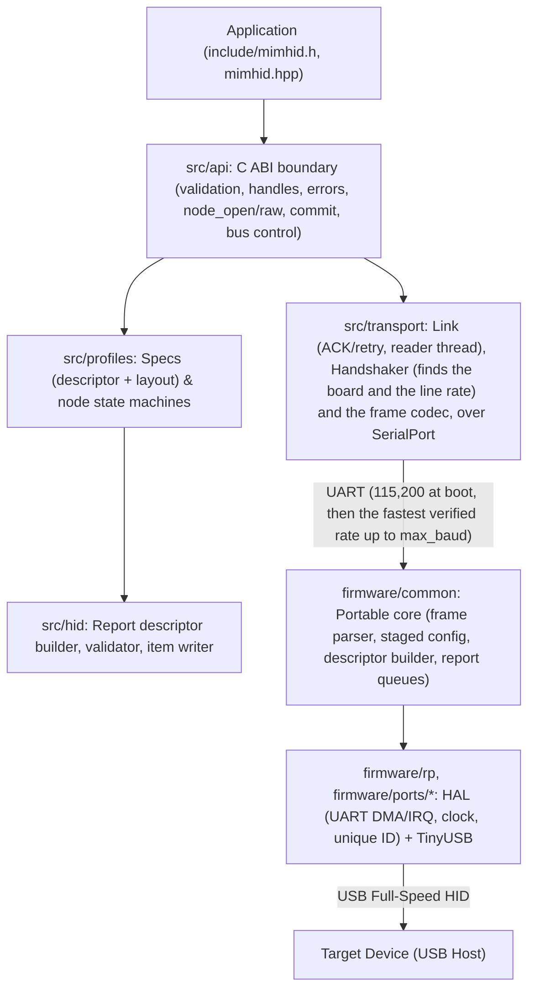
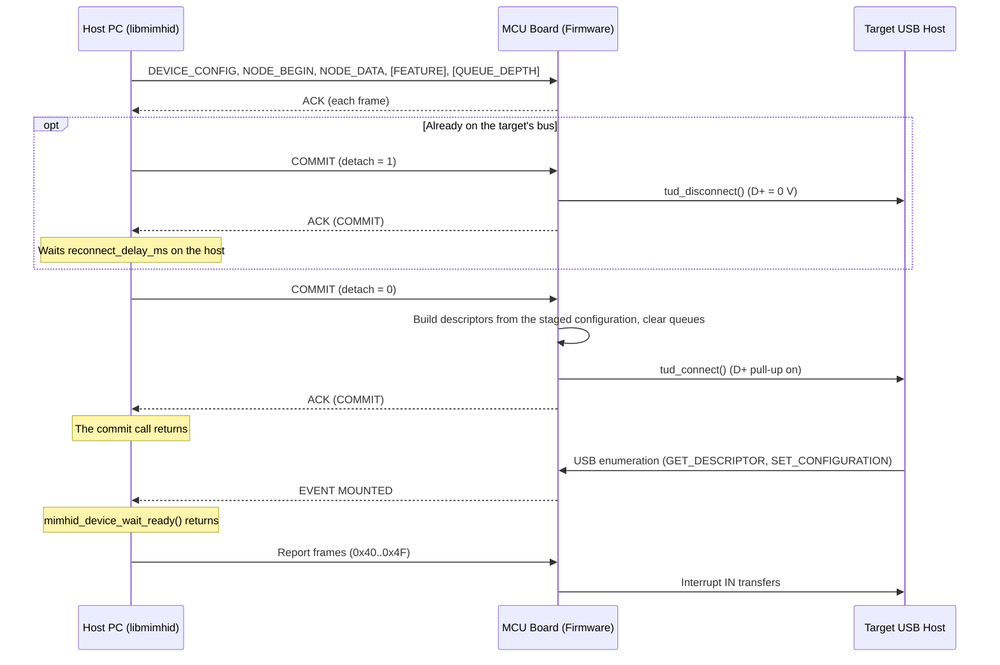

# Architecture

Wire details are in [PROTOCOL.md](PROTOCOL.md), the API model in [API.md](API.md), internal host ownership and locking in [INTERNALS.md](INTERNALS.md), and timing in [LATENCY.md](LATENCY.md).

## libaoahid and libmimhid

`libaoahid` is a USB host that talks Android Open Accessory to a phone. `libmimhid` talks UART to a board that is a USB device to the target, so the target needs no special mode, no app, and no debugging setting.

| | `libaoahid` | `libmimhid` |
|---|---|---|
| Link | PC USB to phone | PC UART to MCU board, board USB to target |
| Target sees | an Android accessory | an ordinary USB HID device with your VID/PID and strings |
| Where reports are built | on the PC | on the PC (the same code) |
| Where descriptors live | registered with the phone by vendor requests | uploaded to the board, served in USB enumeration |

## Layers

The host builds every report. The firmware does not know what a keyboard or a touchscreen is: it holds the descriptors the host uploaded, builds the USB device, configuration, and string descriptors from them, and forwards report bytes to the interface the host assigned.

## Host

- `Spec` is immutable and reference counted; `Node` holds the mutable state (pressed keys, contact slots, pending motion) and the USB interface settings.
- `mimhid_node_open` and `mimhid_node_open_raw` put nodes onto explicit interface numbers (`iface.number` in `mimhid_node_config`).
- Applying a configuration (`mimhid_node_open`, `mimhid_node_open_raw`, `mimhid_node_close`, `mimhid_device_batch_end`, `mimhid_device_commit`, `mimhid_device_set_usb_identity`, and `mimhid_device_connect` on a Device that has not been configured) runs `commit_device` (`src/api/device_ops.cpp`):
  - When nodes are left, the host sends `DEVICE_CONFIG`, every live node's `NODE_BEGIN` and `NODE_DATA`, its registered `FEATURE` answers, and `QUEUE_DEPTH` when one was set. Each frame waits up to `control_timeout_ms` and is sent up to three times.
  - If the board is already on the target's bus, the host sends a detach `COMMIT` (`Link::disconnect`, payload `{1, 0, 0}`) and then waits `reconnect_delay_ms` (the argument of `mimhid_device_commit`; the other calls pass 0) on the host.
  - The host sends an attach `COMMIT` (`Link::connect`, payload `{0, 0, 0}`) and waits up to `reconnect_timeout_ms` for its `ACK`, which the board sends right after building the descriptors and calling `tud_connect()`. The call returns then; `mimhid_device_wait_ready` waits for `EVENT MOUNTED`. While a commit runs, input calls return `MIMHID_ERR_BUSY`.
  - When no node is left, the host sends only a detach `COMMIT`.
- `mimhid_device_connect` and `mimhid_device_disconnect` turn the board's D+ pull-up on and off.
- A reader thread parses frames from the board, completes the pending command, tracks the mounted state, and delivers events to `event_sink`.
- Reports are written from the caller's thread, one `write` each, under a transmit lock (`Link::tx_mutex_`), from a stack buffer (`c_api_send.cpp`).
- Closing a node sends its neutral report (all keys up, contacts lifted) before the configuration changes.

## Interface configuration

Each node names its USB interface with `iface.number` in `mimhid_node_config`; nothing assigns interfaces automatically. Each interface gives `ep_in.address` (`0x81..0x8F`), `ep_in.max_packet_size` (1 to the board's `max_endpoint_bytes`), and an optional OUT endpoint (`ep_out.address` 0 when there is none, otherwise `0x01..0x0F` with `ep_out.max_packet_size` from 1 to `max_endpoint_bytes`), with poll intervals and protocol fields. When a configuration exceeds the board's `max_interfaces`, `max_endpoint_number`, or `max_descriptor_bytes`, `mimhid_node_open` returns `MIMHID_ERR_OVERFLOW`.

## Firmware

`firmware/common/core.c` has two halves that a port runs in one loop (`mimhid_run`) or on two cores:

- **Receive side** (`mimhid_rx_poll`): reads bytes through `hal_uart_read` into a ring (`g_rx`; `RX_SIZE` is 1024, 4096 or 8192 bytes, chosen by `MIMHID_MAX_FRAME_PAYLOAD`), parses frames, and handles reports and some commands. A report goes to its interface's single-producer single-consumer queue of `MIMHID_QUEUE_DEPTH` slots (16, or 8 when a report may be longer than 64 bytes), which holds one report fewer than its slots: 15 or 7. A full queue drops the new report. `mimhid_node_set_queue_depth` makes the bound smaller. `PING`, `SET_BAUD`, `PROBE`, `COUNTERS`, and `CONTROL_REPLY` are handled here; every other command goes into a mailbox for the USB side (`g_cmd`, `cmd_push`: a ring of four slots that holds three commands).
- **USB side** (`mimhid_usb_poll`, after `tud_task`): runs the mailbox commands (`run_command`), staging included: `DEVICE_CONFIG`, `NODE_BEGIN`, and `NODE_DATA` fill the staged configuration (`g_staged`), an attach `COMMIT` builds the descriptors from it (`mimhid_apply_config`), clears the queues, and calls `tud_connect()`, and a detach `COMMIT` calls `tud_disconnect()` and clears the active configuration. It also serves the interface queues in turn, one report per ready endpoint.

`firmware/common/control.c` and `firmware/common/ep0.c` sit between the USB controller driver and TinyUSB. `control.c` wraps `dcd_event_handler` (`-Wl,--wrap=dcd_event_handler`) to see the 8-byte setup packet of every control transfer, reports it to the host when asked, and holds a request that matches a rule until the host replies or the rule's timeout runs out (see [PROTOCOL.md](PROTOCOL.md#control-transfers)). `ep0.c` wraps `dcd_edpt_xfer` and `dcd_edpt_stall` so that with a `usb_device.ep0_max_packet_size` of 8, 16, or 32 bytes, transfers on endpoint 0 are split into packets of that size instead of TinyUSB's compile-time `CFG_TUD_ENDPOINT0_SIZE` (64).

`firmware/common/usb_descriptors.c` builds the device descriptor (VID, PID, class, strings), the configuration descriptor (one HID interface with an IN and an optional OUT endpoint each), and the UTF-16LE string descriptors, and serves each report descriptor. The USB side sends each report with `tud_hid_n_report` and Report ID 0, so the bytes go out as the host sent them, Report ID included. For `GET_REPORT` Input the stack puts the Report ID in front of what the board returns.

On the RP2040 and RP2350 (`firmware/rp/`) the receive side runs on core 1 and the USB side on core 0 (`firmware/rp/main.c`); the UART is read by DMA into a 1024-byte ring (`DMA_BUF_SIZE` in `firmware/rp/hal_rp.c`) placed in the `.scratch_y` SRAM bank, and both cores write to the UART under one critical section (`g_uart_tx_lock`). The other ports run `mimhid_run()` on one core.

## Re-enumeration

## Design decisions

Each decision states what the code does. A reason is given only where the repository records one (a code comment, `CHANGELOG.md`, or a commit message), and says where.

### No values in `*_init`

- **Decision:** Every `mimhid_*_init` function (and its `mimhid::` twin) zeroes its structure and sets `struct_size`, and nothing else. A required field left at zero is refused with `MIMHID_ERR_UNSET_FIELD`, and `mimhid_last_error()` names it. The firmware refuses the same zeros on the wire (`NAK_PARAM`).
- **Reason:** Recorded for one field: `CHANGELOG.md` `[0.2.0]` says a zero vendor ID is refused "so a program that forgot it no longer presents `0000:xxxx` (or, until now, the pid.codes test IDs the initializer used to put in)". `examples/c/example_values.h` says the values it sets "are examples of what a program decides; none is a default of the library". No reason is recorded for the other fields.
- **Rejected:** Initializers with working values. Commit `621900c` added them ("Every options structure has an initializer with working values"); commit `cce3c83` (0.2.0) removed them.

### Every timeout is an argument

- **Decision:** No handle keeps a timeout and `mimhid.h` has no timeout constant. Every call that can wait takes its timeouts as arguments (`mimhid_commit_timeouts` for a commit) and refuses 0 with `MIMHID_ERR_UNSET_FIELD`.
- **Reason:** Not recorded. Commit `4bb017b` states the decision ("All waits are passed per call and none has a default or is kept in the Device").
- **Rejected:** The four `mimhid_transport_options` timeout fields (removed in `4bb017b`) and the constants `MIMHID_CONTROL_TIMEOUT_MS`, `MIMHID_SEND_TIMEOUT_MS`, `MIMHID_DRAIN_TIMEOUT_MS`, and `MIMHID_RECONNECT_TIMEOUT_MS` (removed in `cce3c83`, `CHANGELOG.md` `[0.2.0]`).

### Descriptors and USB identity come from the host

- **Decision:** The host builds every HID report descriptor and sends it, with the USB identity, strings, interfaces, and endpoints, over the serial link (`DEVICE_CONFIG`, `NODE_BEGIN`, `NODE_DATA`, `COMMIT`). The firmware holds no HID profile.
- **Reason:** Not recorded beyond the README's statement of the result: "One firmware image per MCU serves any USB identity, interface layout, and report descriptor sent at runtime."
- **Rejected:** Not recorded.

### D+ stays off until the first `COMMIT` and after a detach

- **Decision:** `mimhid_core_init` calls `tud_disconnect()`, so the D+ pull-up is off from power-up. The board turns it on only for an attach `COMMIT` that succeeds, and turns it off for a detach `COMMIT` and for `mimhid_device_close` (unless `keep_attached` is 1). On the nRF52840, `__wrap_tusb_hal_nrf_power_event` takes the pull-up down again after every USB power event while `mimhid_core_attached()` is false.
- **Reason:** Recorded for the nRF52840: its comment says TinyUSB raises the pull-up "on every USB_EVT_READY ... whatever tud_disconnect() did before", and `CHANGELOG.md` `[0.2.0]` says the change means "a board that has not been committed no longer enumerates as `CAFE:4000` with no interface when the cable is plugged in". Not recorded for the decision as a whole.
- **Rejected:** Not recorded.

### The line rate is found by measurement

- **Decision:** The board boots at 115,200 baud (`MIMHID_BOOT_BAUD`). The host reads `max_baud` from the `PONG`, switches with `SET_BAUD`, and keeps a rate only when three pings and a burst of `PROBE` frames get through with the board's error counters (`COUNTERS`) at zero. The board returns to the boot rate when no valid frame arrives within 100 ms (`MIMHID_BAUD_CONFIRM_MS`) and on a UART `BREAK`.
- **Reason:** Commit `7659d02`: the rate is kept "only after three pings each way, so an adapter that sends at another rate is caught". Commit `bc08c47`: a BREAK returns the board to the boot rate "so a board left on a fast rate is found without searching". `firmware/common/core.c` on BREAK: what the board holds "was sent at the old rate and means nothing".
- **Rejected:** A table of fixed rates, removed in commit `bc08c47` ("The fixed rate table is gone; only the 115,200 boot rate stays"); why the table was dropped is not recorded.

### A stable C ABI over a C++20 implementation

- **Decision:** The libraries export only the `extern "C"` functions of `include/mimhid.h`, through `cmake/mimhid.map` on Linux and `cmake/mimhid.exports` on macOS. On Linux the shared library links the C++ runtime statically (`-static-libstdc++ -static-libgcc`, except in sanitizer builds). C++ exceptions are caught at the C ABI by `MIMHID_C_RESULT_CATCH`, `MIMHID_C_VALUE_CATCH`, and `MIMHID_C_VOID_CATCH` (`src/api/support.hpp`). `include/mimhid.hpp` is a header-only layer over `mimhid.h`, linked through the `mimhid::cpp` CMake target.
- **Reason:** `CMakeLists.txt` records two: "The ABI is plain C: the C++ runtime stays private to the shared object", and the C++ facade target exists so that a pure-C consumer does not have to enable C++ "merely to link the library". Not recorded beyond that.
- **Rejected:** Not recorded.

## Tests

- `tests/unit`: HID layer and profile state machines (`mimhid.unit`). `tests/hidtools/export_descriptors.cpp`: every profile's descriptor compared byte for byte with the files in `tests/golden` (`mimhid.golden-descriptors`).
- `tests/abi`: headers compiled from C11 and C++20 (`mimhid.c-abi`, `mimhid.cpp-wrapper`) and structure layout verification (`mimhid.abi-layout-oracle`).
- `tests/scripted`: the host library run over a pseudo-terminal against a programmable scripted peer (`mimhid.scripted`) that injects NAKs, corrupted CRCs, silent timeouts, rate refusals, and mid-operation hangups.
- `tests/sim`: the host library run against the real firmware core (`firmware/common`) on the build host through a pseudo-terminal (`tests/sim/fake_board.c`), with TinyUSB replaced by recording stubs. It checks the descriptors the target would receive, reports, events, batching, control routing, and error cases for 15-, 7-, and 3-interface Full-Speed builds and a High-Speed build (`mimhid.sim-15`, `mimhid.sim-7`, `mimhid.sim-3`, `mimhid.sim-hs`).
- `firmware/tests`: the firmware core tested directly against a fake HAL with real TinyUSB headers (`test_core_15`, `test_core_7`, `test_core_4`, `test_core_3`, `test_core_hs`; CTest names `firmware_core_15`, `firmware_core_7`, `firmware_core_4`, `firmware_core_3`, `firmware_core_hs`), and `firmware/tests/itfs_probe.c`, built in every header order (`itfs_first_core_*`, `itfs_first_tusb_*`) and with each required build definition missing (`missing_*`).
- See [VERIFICATION.md](VERIFICATION.md) for the verification matrix and where the coverage figures are reported.
