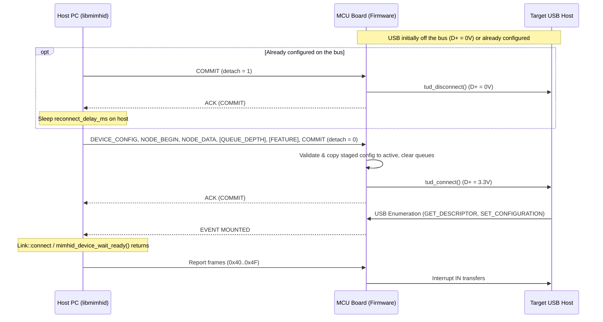

# Architecture

Wire details are in [PROTOCOL.md](PROTOCOL.md), the API model in [API.md](API.md), internal host ownership and locking in [INTERNALS.md](INTERNALS.md), and timing in [LATENCY.md](LATENCY.md).

## libaoahid and libmimhid

`libaoahid` is a USB host that talks Android Open Accessory to a phone. `libmimhid` talks UART to a board that is a USB device to the target, so the target needs no special mode, no app, and no debugging setting.

| | `libaoahid` | `libmimhid` |
|---|---|---|
| Link | PC USB to phone | PC UART to MCU board, board USB to target |
| Target sees | an Android accessory | an ordinary USB HID device with your VID/PID and strings |
| Where reports are built | on the PC | on the PC (the same code) |
| Where descriptors live | registered with the phone by vendor requests | uploaded to the board, served in USB enumeration |

## Layers

The host builds every report. The firmware does not know what a keyboard or a touchscreen is: it holds the descriptors the host uploaded, builds the USB device, configuration, and string descriptors from them, and forwards report bytes to the interface the host assigned.

## Host

- `Spec` is immutable and reference counted; `Node` holds the mutable state (pressed keys, contact slots, pending motion) and the USB interface settings.
- `mimhid_node_open` and `mimhid_node_open_raw` put nodes onto explicit interface numbers (`iface.number` in `mimhid_node_config`).
- Applying a configuration (`mimhid_node_open`, `mimhid_node_open_raw`, `mimhid_node_close`, `mimhid_device_batch_end`, `mimhid_device_commit`, `mimhid_device_set_usb_identity`, `mimhid_device_connect`) runs `commit_device` (`src/api/device_ops.cpp`):
  - If the board is already configured on the USB bus, the host first sends a detach `COMMIT` (`Link::disconnect`, payload `{1, 0, 0}`) and sleeps `usb_config.reconnect_delay_ms` on the host.
  - The host then sends `DEVICE_CONFIG`, every live node's `NODE_BEGIN`, `NODE_DATA`, optional `QUEUE_DEPTH`, and registered `FEATURE` answers, followed by an attach `COMMIT` (`Link::connect`, payload `{0, delay_lo, delay_hi}`).
  - `Link::connect` waits up to 500 ms for the board's `ACK` to `COMMIT` (which the board sends immediately after applying the staged configuration and calling `tud_connect()`) and then waits up to `reconnect_timeout_ms` for the board to report `EVENT MOUNTED` once the target USB host completes `SET_CONFIGURATION`. While this runs, input calls return `MIMHID_ERR_BUSY`.
- `mimhid_device_connect` and `mimhid_device_disconnect` command physical `D+ = 3.3 V` attachment or `D+ = 0 V` stealth disconnection.
- A reader thread parses frames from the board, answers nothing itself, completes pending commands, tracks the mounted state, and delivers events to `event_sink`.
- Reports are written from the caller's thread, one `write` each, under a transmit lock (`Link::tx_mutex_`). No heap allocation happens on this path.
- Closing a node sends its neutral report (all keys up, contacts lifted) before the configuration changes.

## Interface configuration

In `libmimhid`, each node explicitly specifies its USB `iface.number` (`0, 1, 2, ...`) via `mimhid_node_config`. There is no automatic interface assignment. Each interface specifies `ep_in.address` (`0x81..0x8F`), `ep_in.max_packet_size` (`1` to the board's `max_endpoint_bytes`, e.g. `64`), and an optional OUT endpoint (`ep_out.address == 0` when disabled, otherwise `0x01..0x0F` with `ep_out.max_packet_size` from `1` to `max_endpoint_bytes`) along with poll intervals and protocol parameters. If a configuration exceeds the board's `max_interfaces`, `max_endpoint_number`, or `max_descriptor_bytes`, `mimhid_node_open` returns `MIMHID_ERR_OVERFLOW`.

## Firmware

`firmware/common/core.c` has two halves that a port runs in one loop (`mimhid_run`) or across two cores:

- **Receive side** (`mimhid_rx_poll`): reads bytes through `hal_uart_read` into a `16,384`-byte ring buffer (`MIMHID_UART_RX_RING_LEN` in `firmware/common/config.h`), parses frames, and handles reports and commands. Reports go to a per-interface lock-free single-producer single-consumer (SPSC) queue that holds 15 reports (`MIMHID_REPORT_QUEUE_LEN = 16`, or 7 reports when `MIMHID_MAX_REPORT_BYTES > 64`); `mimhid_node_set_queue_depth` can shorten that bound at runtime. Commands other than `PING`, `SET_BAUD`, `PROBE`, `COUNTERS`, and `CONTROL_REPLY` are pushed into a single-slot command mailbox (`cmd_slot`) so that the USB side executes them; the receive side never touches the active descriptors.
- **USB side** (`mimhid_usb_poll`, paired with `tud_task`): executes mailbox commands (`COMMIT` with `detach=1` calls `tud_disconnect()` and clears the active configuration; `COMMIT` with `detach=0` validates and copies the staged configuration into `active`, clears the queues, and calls `tud_connect()`), and services the interface queues in rotation, one report per ready endpoint.

`firmware/common/control.c` and `firmware/common/ep0.c` sit between the USB controller driver and TinyUSB: `control.c` wraps `dcd_event_handler` (`-Wl,--wrap=dcd_event_handler`) to inspect the 8-byte setup packet of every control transfer, optionally reports it to the host, and for rule-matched requests holds it until the host replies or the rule's timeout expires (see [PROTOCOL.md](PROTOCOL.md#control-transfers)). `ep0.c` wraps `dcd_edpt_xfer` and `dcd_edpt_stall` so that when `usb_device.ep0_max_packet_size` is 8, 16, or 32 bytes, transfers on endpoint 0 are split into packets of that size instead of TinyUSB's compile-time `CFG_TUD_ENDPOINT0_SIZE` (64).

`firmware/common/usb_descriptors.c` builds the device descriptor (VID, PID, class, strings), the configuration descriptor (one HID interface with IN and optional OUT endpoints per interface), and the UTF-16LE string descriptors, and serves each report descriptor. TinyUSB 0.18.0 specifics: `GET_REPORT` input includes the Report ID when the interface uses IDs, and `tud_hid_n_report` with ID 0 sends the buffer as is.

Both the Raspberry Pi Pico (RP2040) and Raspberry Pi Pico 2 (RP2350) have official dual-core support (`firmware/rp/`): the receive side runs on core 1 and the USB side on core 0; the 4 KiB UART DMA ring sits in the dedicated `.scratch_y` SRAM bank so that core 1's ring reads do not contend with core 0 on the main SRAM fabric. The other ports run `mimhid_run()` on a single core.

## Re-enumeration

## Design decisions

Each architectural choice below states what the library does, why it does so, which alternative was rejected, and where the rationale is recorded in the repository.

### 1. Explicit `MIMHID_ERR_UNSET_FIELD` instead of defaults in `*_init`

- **Decision:** Every `mimhid_*_init` function (and its `mimhid::` C++ twin) zeroes its structure, sets `struct_size`, and fills in no operational values. Leaving any required field at zero causes the factory or open call to fail immediately with `MIMHID_ERR_UNSET_FIELD` and name the missing field in `mimhid_last_error()`. The firmware enforces the same rule on the wire (`NAK_PARAM` for zero `bcdUSB`, `language_id`, `bcdHID`, or IN endpoint fields).
- **Reason:** A library that guesses USB identities (such as the `1209:0001` pid.codes test VID/PID), HID usage ranges, endpoint numbers, polling intervals, or Linux kernel parser limits silently leaks test values into production devices when a caller forgets to set a field. Requiring every field to be set at the call site forces the application to choose the exact identity, layout, and limits of the device it emulates (`CHANGELOG.md` `[0.2.0]`, commits `cce3c83`, `663eec9`, `b2b936f`, `include/mimhid.h:753-758`, `examples/c/example_values.h:3-7`, `src/hid/validator.hpp:27-30`).
- **Rejected alternative:** Pre-filling "sensible defaults" (for example, `1209:0001`, 1080p touchscreen bounds, 1000 Hz polling, and Linux 6.x HID parser constants) in `*_init`, which was tried in earlier revisions (`621900c`) and removed in `0.2.0` (`cce3c83`) because callers could inadvertently ship test VIDs/PIDs or mismatched descriptor bounds without any compiler or runtime diagnostic.

### 2. Every timeout is an explicit call argument; no timeout is stored on a handle

- **Decision:** No handle stores a default timeout, and no `MIMHID_*_TIMEOUT_MS` constant exists in `include/mimhid.h`. Every call that can wait (`mimhid_discover`, `mimhid_device_open`, `mimhid_node_open`, `mimhid_node_submit`, `mimhid_device_wait_ready`, `mimhid_device_close`, control routing) takes its timeout(s) as explicit parameter(s) and rejects `0` with `MIMHID_ERR_UNSET_FIELD`.
- **Reason:** Different operations have fundamentally different timing bounds (a single UART report write vs. a control-pipe round trip vs. a full USB bus re-enumeration), and the acceptable wait depends on the caller's event loop and serial adapter latency timer (`include/mimhid.h:48-50`, commit `4bb017b`, `CHANGELOG.md` `[0.2.0]`).
- **Rejected alternative:** Storing global or per-device default timeouts set at open time, or providing header constants (`MIMHID_CONTROL_TIMEOUT_MS`, `MIMHID_SEND_TIMEOUT_MS`, `MIMHID_DRAIN_TIMEOUT_MS`, `MIMHID_RECONNECT_TIMEOUT_MS`), which hid blocking durations from call sites and were removed in commit `4bb017b`.

### 3. Descriptors and USB identity uploaded from the host at runtime instead of reflashing the board

- **Decision:** The host library generates all HID report descriptors and sends the USB device identity, strings, interface assignments, endpoint addresses/sizes/intervals, and report descriptors over UART (`DEVICE_CONFIG`, `NODE_BEGIN`, `NODE_DATA`, `COMMIT`). The firmware holds no built-in HID profiles.
- **Reason:** Keeping profile generation and validation on the host PC allows a single firmware binary per board family to emulate any combination of keyboards, mice, touchscreens, touchpads, pens, gamepads, toggles, or raw descriptors, and to share the exact descriptor builder, layout engine, and validator with `libaoahid` (`docs/ARCHITECTURE.md:13-14,38`, `firmware/common/core.c:72-97`, `firmware/common/usb_descriptors.c:12-23`).
- **Rejected alternative:** Compiling fixed HID descriptors or profile logic into the MCU firmware, which would require reflashing the microcontroller whenever the emulated device's VID/PID, strings, interface layout, or axis ranges change.

### 4. `0 V` stealth waiting (`D+` held low) until the first `COMMIT` and after detach

- **Decision:** On boot, `mimhid_core_init` calls `tud_disconnect()` so the USB `D+` pull-up resistor is disabled (`0 V`), and on nRF52840 `--wrap=tusb_hal_nrf_power_event` pulls `D+` back down whenever VBUS rises while `mimhid_core_attached()` is false. The board connects to the target's USB bus (`3.3 V` on `D+`) only when a `COMMIT` with `detach == 0` succeeds, and drops back to `0 V` on a detach `COMMIT` or `mimhid_device_close` (unless `keep_attached == 1`).
- **Reason:** Before the host program connects and commits its configuration, the board has no valid VID/PID, strings, or HID interfaces. If the USB pull-up were enabled at power-on or VBUS rise, the target OS would enumerate a placeholder device (`CAFE:4000` with zero interfaces) before the user's program even started (`firmware/common/core.h:50-56`, `firmware/common/core.c:860-865`, `firmware/ports/nrf52840/hal_nrf52.c:16-31`, commit `cce3c83`, `CHANGELOG.md` `[0.2.0]`).
- **Rejected alternative:** Leaving TinyUSB connected at boot with a default descriptor and re-enumerating later, which exposes the board's presence and a placeholder identity to the target machine whenever power is applied.

### 5. Runtime line-rate discovery (`SET_BAUD` + `PROBE` + `COUNTERS`) and `BREAK` recovery instead of a fixed baud rate or static table

- **Decision:** The board always boots at `115,200` baud (`MIMHID_BOOT_BAUD`). The host queries `max_baud` in the `PONG`, switches the line with `SET_BAUD`, verifies the rate with a burst of `PROBE` frames and the board's hardware/ring error counters (`COUNTERS`), and falls back to `115,200` baud automatically if no valid frame arrives within `100 ms` (`MIMHID_BAUD_CONFIRM_MS`) or when the host sends a `10 ms` UART `BREAK`.
- **Reason:** Different USB-UART adapters and MCU clocks support widely different maximum rates (`1 Mbaud` on nRF52840 up to `7.8125 Mbaud` on RP2040 and `9.375 Mbaud` on RP2350), and some USB-serial drivers silently accept a requested baud rate while transmitting at another or dropping bytes at marginal dividers. Measuring actual frame delivery with `PROBE` and `COUNTERS` guarantees the chosen rate is lossless on the physical wire, while `BREAK`-to-boot-baud recovery ensures a crashed host process never leaves the board stranded on an unknown high baud rate (`proto/mimhid_proto.h:164-200`, `src/transport/handshaker.cpp:7-16`, `docs/PROTOCOL.md:78-95`, commits `7659d02` and `bc08c47`).
- **Rejected alternative:** A fixed baud rate (such as `115,200` or `921,600`, which increases UART wire time) or a static table of standard baud rates trusted without link-error measurement (used before commit `bc08c47`, which could select a rate that silently dropped bytes or could not use the RP2040's exact integer dividers such as `7,812,500` baud).

### 6. Stable C11 ABI (`include/mimhid.h`) with a private C++20 implementation and a header-only C++20 facade (`include/mimhid.hpp`)

- **Decision:** The shared and static libraries export only `extern "C"` functions with a versioned symbol script (`cmake/mimhid.map` on Linux, `-exported_symbols_list` on macOS) and link no C++ standard library symbols into the public ABI (`-static-libstdc++ -static-libgcc` on Linux). All C++ exceptions are caught at the `MIMHID_C_RESULT_CATCH` / `MIMHID_C_VALUE_CATCH` / `MIMHID_C_VOID_CATCH` boundary in `src/api/support.hpp`. `include/mimhid.hpp` is a header-only `mimhid::cpp` RAII wrapper layered strictly on top of `include/mimhid.h`.
- **Reason:** A pure C11 ABI with `struct_size`-versioned option structs can be consumed directly by C, C++, Python (`ctypes`), C# (`LibraryImport`), and Rust (`extern "C"`) without C++ name mangling or `libstdc++`/`libc++` ABI mismatches, while the implementation still benefits from C++20 (`std::variant`, `std::atomic`, RAII locks) internally (`CMakeLists.txt:226-234,266-290`, `src/api/support.hpp:23-62`, commits `43b015a` and `bc6e6da`).
- **Rejected alternative:** Exporting C++ classes from the shared library (which breaks across compilers, standard libraries, and FFI generators) or writing the internal state machines and transport in C (losing type-safe `std::variant` dispatch and RAII lock guards).

## Tests

- `tests/unit`: HID layer and profile state machines (`mimhid.unit`). `tests/hidtools`: descriptors checked against `libaoahid`'s golden files (`mimhid.golden-descriptors`).
- `tests/abi`: headers compiled from C11 and C++20 (`mimhid.c-abi`, `mimhid.cpp-wrapper`) and structure layout verification (`mimhid.abi-layout-oracle`).
- `tests/scripted`: the host library run over a pseudo-terminal against a programmable scripted peer (`mimhid.scripted`) that injects NAKs, corrupted CRCs, silent timeouts, rate refusals, and mid-operation hangups.
- `tests/sim`: the host library run against the real firmware core (`firmware/common`) on the build host through a pseudo-terminal (`tests/sim/fake_board.c`), with TinyUSB replaced by recording stubs. It checks the descriptors the target would receive, reports, events, batching, control routing, and error cases for 15-, 7-, and 3-interface Full-Speed builds and a High-Speed build (`mimhid.sim-15`, `mimhid.sim-7`, `mimhid.sim-3`, `mimhid.sim-hs`).
- `firmware/tests`: the firmware core tested directly against a fake HAL with real TinyUSB headers (`test_core_15`, `test_core_7`, `test_core_4`, `test_core_3`, `test_core_hs`; CTest names `firmware_core_15`, `firmware_core_7`, `firmware_core_4`, `firmware_core_3`, `firmware_core_hs`).
- See [VERIFICATION.md](VERIFICATION.md) for the complete verification matrix and coverage numbers.
